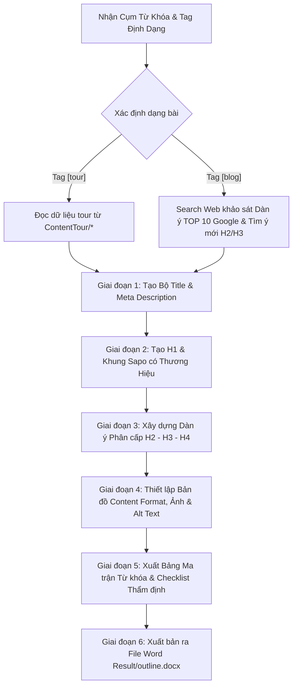

# WORKFLOW: QUY TRÌNH TẠO DÀN BÀI (OUTLINE) CHUẨN SEO CHO CỤM TỪ KHÓA

Quy trình này hướng dẫn chi tiết từng bước mà Agent thực hiện ngay khi nhận được **Cụm từ khóa (Primary Keyword & Keyword Cluster)** từ người dùng, đảm bảo tạo ra một Dàn bài (Outline) bài viết chuẩn SEO 100% theo quy chuẩn dự án.

---

## TỔNG QUAN LUỒNG THỰC THI (5 GIAI ĐOẠN)



---

## CHI TIẾT CÁC BƯỚC TRIỂN KHAI

### BƯỚC 1: TIẾP NHẬN TỪ KHÓA & PHÂN LOẠI DẠNG BÀI VIẾT ([tour] vs [blog])
1. **Nhận diện dạng bài viết qua tag**:
   - **Tag `[tour]` (hoặc mặc định có file tour)**: Bài viết bán/giới thiệu tour du lịch.
     * Mở và đọc dữ liệu thực tế từ file trong thư mục `ContentTour/*` (lịch trình mốc giờ, bảng giá, quyền lợi bao gồm/loại trừ, lưu ý khi đi tour).
     * Giữ cấu trúc tour chuẩn hiện tại.
   - **Tag `[blog]`**: Bài viết cẩm nang, chia sẻ kinh nghiệm, kiến thức, review du lịch.
     * **Khảo sát dàn ý của 10 đối thủ đầu tiên (TOP 10 SERP Google)**: Dùng công cụ `search_web` tìm kiếm từ khóa chính, tổng hợp khung heading (H2, H3) của 10 bài viết đứng đầu Google.
     * **Sắp xếp hợp lý, giải quyết đúng và đủ Intent người đọc**: Đánh giá toàn diện Search Intent, gom nhóm các ý cốt lõi, loại bỏ nội dung rác/thừa, tổ chức các đề mục theo mạch tư duy logic, dễ hiểu.
     * **Tìm ý mới mẻ trong thẻ H2, H3 (Content Freshness & Information Gain)**: Chủ động tìm tòi và bổ sung các góc nhìn mới lạ, kinh nghiệm thực chiến độc đáo mà 10 đối thủ chưa có hoặc chưa làm rõ (góc check-in độc lạ, khung giờ vàng săn ảnh, quán ăn ngõ ngách bản địa, mẹo tránh đông, kinh nghiệm tiết kiệm chi phí...).
2. **Quy định bắt buộc về danh sách từ khóa (Strict Keyword Inventory)**:
   - **Chỉ sử dụng đúng số lượng và cụm từ khóa do người dùng cung cấp**.
   - Tuyệt đối **KHÔNG tự ý bịa đặt, suy diễn, mở rộng hay thêm bớt** bất kỳ từ khóa nào khác (nghiêm cấm tự thêm "từ khóa liên quan", "từ khóa LSI tự nghĩ", "từ khóa phụ tự sinh").
   - Xác định rõ vai trò: Key chính (Key có Search Intent bao quát hoặc Volume cao nhất), các Key phụ (các cụm từ khóa còn lại trong danh sách người dùng đưa). Cột "Từ khóa mục tiêu" trong Ma trận phân bổ chỉ chứa các key này, các mục không chèn key thì để dấu `-`.

---

### BƯỚC 2: THIẾT KẾ TIÊU ĐỀ (SEO TITLE) & MÔ TẢ (META DESCRIPTION)
* **Đề xuất 3 phương án SEO Title (tối ưu Key 1)**:
  - Chuẩn 55 - 60 ký tự (kiểm soát ngầm bên dưới, không in số ký tự).
  - Tối ưu 1 cụm từ khóa mục tiêu đứng ngay đầu câu.
  - Chứa con số, từ bổ trợ, dấu `|` hoặc `-`, độc nhất (unique).
* **Đề xuất 2 phương án Meta Description**:
  - Chuẩn 140 - 155 ký tự (kiểm soát ngầm bên dưới).
  - Từ khóa chính ở đầu, từ khóa phụ ở vế sau.
  - Gợi mở nỗi đau/tò mò, **không trả lời ngay kết quả**.
  - Kết thúc bắt buộc bằng CTA: *Click xem ngay!, Xem thêm!...*

---

### BƯỚC 3: XÁC LẬP TIÊU ĐỀ BÀI VIẾT (H1) & KHUNG MỞ BÀI (SAPO)
* **Heading 1 (H1) - BẮT BUỘC KHÁC TITLE 100% (NGHIÊM CẤM TRÙNG LẶP DƯỚI MỌI HÌNH THỨC)**:
  - H1 và Title là 2 tiêu đề độc lập hoàn toàn, tuyệt đối không được dùng chung câu chữ hay sao chép nguyên văn của nhau.
  - **Khi có ≥ 2 từ khóa**: H1 tối ưu **Key 2** (hoàn toàn khác Key 1 của Title, chọn từ danh sách người dùng cấp).
  - **Khi CHỈ CÓ 1 TỪ KHÓA DUY NHẤT (Single Keyword)**: Title và H1 **VẪN BẮT BUỘC PHẢI KHÁC NHAU 100%**:
    * Cùng chứa từ khóa chính đó, nhưng khác biệt hoàn toàn về cấu trúc câu, từ ngữ bổ trợ và góc giật tít.
    * **SEO Title**: Thiên về kích thích CTR, bán tour/dịch vụ/lịch trình (Key ở đầu + số ngày đêm/giá tour + dấu `|` hoặc `-`). Ví dụ: `Tour Trùng Khánh Lệ Giang Shangrila 6N5Đ | Giá Tốt Trọn Gói`.
    * **Thẻ H1**: Thiên về cẩm nang trải nghiệm, khám phá thực tế, bao quát toàn bài (Dùng động từ/cấu trúc khác biệt như: "Khám Phá...", "Kinh Nghiệm Đi...", "Lịch Trình Chi Tiết..."). Ví dụ: `Khám Phá Tour Trùng Khánh Lệ Giang Shangrila Chi Tiết Từ A-Z`.
  - **Cơ chế Tự Rà Soát (Self-Check Validation)**: Trước khi xuất dàn bài ra file Word, Agent bắt buộc đối chiếu Title và H1. Nếu phát hiện trùng nhau hoặc giống nhau >70%, Agent xem đây là lỗi nghiêm trọng và phải viết lại H1 ngay lập tức.
* **Định hướng Sapo (Ngắn gọn, Thu hút & Nhắc Thương Hiệu)**:
  - 2 - 3 dòng (dưới 155 từ), mở đầu hấp dẫn, khơi gợi tò mò.
  - Chứa từ khóa chính ngay trong 100 từ đầu tiên, giải quyết bài toán của Title và H1.
  - **Khéo léo nhắc tên thương hiệu của công ty** ngay trong đoạn mở đầu một cách tự nhiên.

---

### BƯỚC 4: XÂY DỰNG CẤU TRÚC PHÂN CẤP HEADINGS (H2, H3, H4)
Tuân thủ nghiêm ngặt các quy tắc:
1. **Quy tắc số lượng**: Tối thiểu từ **4 H2 trở lên**. Mỗi H2 phải có từ **2 H3 trở lên**.
2. **Quy tắc độ dài**: Mỗi heading dưới **60 ký tự**.
3. **Quy tắc từ khóa**:
   - **H2 đầu tiên**: Bắt buộc chứa từ khóa chính.
   - **Các H2 tiếp theo**: Phân bổ từ khóa phụ, từ khóa mở rộng, từ khóa liên quan.
   - Trong mỗi phân đoạn thân bài của 1 H3 chỉ nhắm tối đa 1 key.
4. **Quy tắc phân tầng**: H4 bổ trợ cho H3, H3 bổ trợ cho H2, H2 bổ trợ cho H1.
5. **Quy tắc đoạn áp chót**: H2 hoặc H3 cuối cùng trước Kết luận không được làm sơ sài hoặc quá ngắn.
6. **Quy tắc khai thác ý mới mẻ trong thẻ H2, H3 (Content Freshness & Information Gain)**:
   - Tìm kiếm và đưa vào các góc nhìn độc đáo, chi tiết mới lạ, thực tế từ tài liệu tour hoặc kinh nghiệm thực chiến (mẹo tránh đông đúc, góc check-in ít người biết, khung giờ săn mây lý tưởng, trải nghiệm ẩm thực bản địa độc lạ, lưu ý thời tiết theo mùa...).
   - Tuyệt đối không rập khuôn hay lặp lại các ý tiêu đề xơ cứng phổ thông trên mạng. Tạo điểm nhấn thông tin giá trị vượt trội giúp bài viết thu hút và nổi bật.

---

### BƯỚC 5: XÂY DỰNG Ý CHÍNH DƯỚI DẠNG BULLET & QUY HOẠCH TINH GỌN
1. **Phong cách trình bày tối giản (Minimalist & Direct)**:
   - Dưới mỗi Heading (H2, H3) **chỉ liệt kê các ý chính/thông tin cốt lõi dưới dạng bullet points** (`- [Ý chính...]`).
   - **Tuyệt đối KHÔNG giải thích dài dòng** hay chèn nhãn thừa dưới tiêu đề (không viết `Mục tiêu nội dung`, `Định dạng`, `Ý triển khai:`, `Hình ảnh:...`).
   - Tiêu đề để sạch sẽ, súc tích.
2. **Quy hoạch định dạng & Hình ảnh tập trung**:
   - Vị trí chèn Bảng (Table), Danh sách (List), Box Lưu ý cũng như kế hoạch Hình ảnh và Alt text được quy hoạch gọn gàng tại **Bảng Ma Trận Phân Bổ** (Giai đoạn 5), không chèn rải rác làm loãng dàn ý.

---

### BƯỚC 6: XÂY DỰNG KẾT LUẬN & BẢNG ĐIỀU PHỐI TỪ KHÓA
* **Phần Kết luận**: Viết thật ngắn gọn, súc tích (chỉ từ 2 - 3 câu ngắn hoặc dưới 50 - 80 từ), tóm tắt nhanh giá trị cốt lõi, bắt buộc chứa 1 lần từ khóa chính + **lời kêu gọi hành động (CTA) dứt khoát gắn liền với số Zalo tư vấn và tên thương hiệu của công ty** (nếu người dùng có cung cấp). Tuyệt đối không chèn ảnh hay ghi chú ảnh ở Kết luận.
* **Bảng Ma trận phân bổ từ khóa (Keyword Distribution Matrix)**:
  - Thống kê vị trí rải từ khóa đảm bảo mật độ tổng bài 1.5% - 2.5% (tối đa 3.0%).
  - **Tỉ lệ từ khóa phải trải đều trong toàn bài và trong từng mục (H2, H3)**: Mật độ không quá dày, không xuất hiện quá gần nhau (cấm nhồi 2 key liền kề); đồng thời không để khoảng cách quá xa mới xuất hiện key 1 lần.
  - **Câu chữ linh hoạt, tự nhiên**: Từ khóa phải hòa tan khéo léo vào ngữ cảnh diễn đạt thực tế của người viết.
  - Tích hợp kế hoạch Định dạng (Table/List) và Ảnh + Alt text.
* **Bảng Checklist Thẩm định**: Rà soát lại toàn bộ tiêu chí kỹ thuật trước khi bàn giao dàn bài cho người dùng.

---

### BƯỚC 7: XUẤT BẢN RA FILE WORD DOCX VÀO THƯ MỤC RESULT/
* Dữ liệu nguồn tour được trích xuất từ `ContentTour/*` (giữ nguyên vẹn, không chỉnh sửa file nguồn).
* Lưu dàn ý nền tạm vào `outline.md` (tự động xóa sau khi convert).
* Tự động chạy script đóng gói vào thư mục `Result/`:
  ```powershell
  python .agents/scripts/md_to_docx.py outline.md Result/outline.docx
  ```
* Bàn giao file `Result/outline.docx` để người dùng mở trực tiếp bằng Microsoft Word hoặc Google Docs.

---

## TEMPLATE XUẤT BẢN DÀN BÀI CHUẨN (STANDARD OUTPUT FORMAT)

Mỗi khi người dùng cung cấp cụm từ khóa, Agent sẽ trả về kết quả theo đúng cấu trúc tiêu chuẩn dưới đây:

```markdown
# DÀN BÀI CHUẨN SEO: [TÊN TỪ KHÓA CHÍNH]

## I. THÔNG TIN TỔNG QUAN & PHÂN TÍCH TỪ KHÓA
- Danh sách từ khóa người dùng cung cấp:
  1. [Từ khóa chính] (Volume: ...)
  2. [Từ khóa phụ 1] (Volume: ...)
  3. [Từ khóa phụ 2] (Volume: ...)
- Ý định tìm kiếm (Search Intent): [Phân tích chi tiết nhu cầu người đọc]
*(Cam kết: Sử dụng chuẩn xác 100% số lượng cụm từ khóa trên, tuyệt đối không tự bịa đặt hay thêm bớt bất kỳ từ khóa nào khác).*

## II. BỘ TIÊU ĐỀ & MÔ TẢ TỐI ƯU
### 1. Đề xuất SEO Title (Chuẩn 55 - 60 ký tự - Tối ưu Key 1)
- Option 1 (Khuyên dùng): [Tiêu đề 1 chứa Key 1]
- Option 2: [Tiêu đề 2 chứa Key 1]
- Option 3: [Tiêu đề 3 chứa Key 1]

### 2. Đề xuất Thẻ H1 (Tiêu đề bài viết trên trang - BẮT BUỘC KHÁC 100% so với SEO Title trong mọi trường hợp)
- Option 1 (Khuyên dùng): [Tiêu đề H1 chứa Key 2]
- Option 2: [Tiêu đề H1 chứa Key 2]
- Option 3: [Tiêu đề H1 chứa Key 2]

### 3. Đề xuất Meta Description (Chuẩn SEO 140 - 155 ký tự)
- Option 1 (Khuyên dùng): [Mô tả 1 có CTA]
- Option 2: [Mô tả 2 có CTA]

### 4. Khung định hướng Sapo (Ngắn gọn 2-3 dòng, <155 từ, thu hút, nhắc tên thương hiệu công ty và chứa Key chính trong 100 từ đầu)
- [Đoạn Sapo mẫu gợi ý]

---

## III. DÀN Ý CHI TIẾT (OUTLINE HIERARCHY - COPY & USE READY)

### 1. [Tiêu đề H2 đầu tiên chứa Key chính]
- [Ý chính 1 / thông tin cốt lõi]
- [Ý chính 2 / dữ liệu quan trọng từ file ContentTour/*]
  #### 1.1. [Tiêu đề con H3]
  - [Ý triển khai 1]
  - [Ý triển khai 2]
  #### 1.2. [Tiêu đề con H3]
  - [Ý triển khai 1]
  - [Ý triển khai 2]

### 2. [Tiêu đề H2 chứa Key phụ 1]
- [Ý chính 1]
- [Ý chính 2]
  #### 2.1. [Tiêu đề con H3]
  - [Ý triển khai 1]
  - [Ý triển khai 2]
  #### 2.2. [Tiêu đề con H3]
  - [Ý triển khai 1]
  - [Ý triển khai 2]

### 3. [Heading trọng tâm - Chứa Key phụ 2 / Key mở rộng] ⭐ [TRỌNG TÂM]
- [Ý chính 1]
- [Ý chính 2]
  #### 3.1. [Tiêu đề con H3]
  - [Ý triển khai 1]
  - [Ý triển khai 2]
  #### 3.2. [Tiêu đề con H3]
  - [Ý triển khai 1]
  - [Ý triển khai 2]

### 4. [Kinh nghiệm / Lời khuyên thực tế]
- [Ý chính 1]
- [Ý chính 2]
  #### 4.1. [Tiêu đề con H3]
  - [Ý triển khai 1]
  - [Ý triển khai 2]
  #### 4.2. [Tiêu đề con H3]
  - [Ý triển khai 1]
  - [Ý triển khai 2]

### 5. Kết Luận
- [Tóm lược ngắn gọn 2 - 3 câu (<50-80 từ), lặp lại 1 lần Từ khóa chính]
- [Lời kêu gọi hành động CTA dứt khoát gắn liền với số Zalo tư vấn và thương hiệu công ty]

---

## IV. MA TRẬN PHÂN BỔ TỪ KHÓA & FORMAT TRÌNH BÀY
*(Cột "Từ khóa mục tiêu" CHỈ PHÉP điền các key người dùng đã giao, các mục không chèn key thì để dấu `-`, tuyệt đối không tự bịa thêm key khác. Đảm bảo từ khóa phân bổ trải đều trong từng mục, không để khoảng cách quá xa).*
| Phần | Thẻ Heading | Từ khóa mục tiêu | Định dạng hiển thị | Kế hoạch Ảnh & Ghi chú mô tả ảnh |
| :--- | :--- | :--- | :--- | :--- |
| Mở bài | Sapo | [Key chính] | Đoạn văn ngắn 2-3 dòng, thu hút | - |
| Thân 1 | Mục 1 (H2) | [Key chính] | Text + Bullet | Ảnh 1: (Mô tả ảnh ngắn gọn) |
| Thân 1.1 | Mục 1.1 (H3) | [Key phụ / liên quan] | Text + Bullet | Ảnh 2: (Mô tả ảnh ngắn gọn) |
| Thân 2 | Mục 2 (H2) | [Key phụ 1] | Lịch trình + Timeline | Ảnh 3: (Mô tả ảnh ngắn gọn) |
| Thân 3 | Mục 3 (H2) | [Key phụ 2] | Bảng giá / Table | Ảnh 4: (Mô tả ảnh ngắn gọn) |
| Thân 4 | Mục 4 (H2) | - | Text + Checklist chuẩn bị | Ảnh 5: (Mô tả ảnh ngắn gọn) |
| Kết bài | Mục 5 (H2) | [Key chính] | Text ngắn gọn 2-3 câu + CTA | - |

---

## V. CHECKLIST KIỂM SOÁT DÀN Ý TRƯỚC KHI BÀN GIAO
- [ ] SEO Title đạt 55 - 60 ký tự, tối ưu Key 1 ở đầu, có số, từ bổ trợ, dấu `|` hoặc `-`.
- [ ] Thẻ H1 BẮT BUỘC KHÁC SEO TITLE 100% (không trùng lặp câu chữ kể cả khi chỉ có 1 từ khóa duy nhất).
- [ ] Description đạt 140 - 155 ký tự, có CTA kích thích click, không tiết lộ đáp án.
- [ ] Sapo ngắn gọn 2 - 3 dòng (<155 từ), thu hút, có Key chính trong 100 từ đầu, giải quyết đúng tiêu đề bài viết và khéo léo nhắc tên thương hiệu công ty.
- [ ] Các thẻ H2, H3 khai thác ý mới mẻ, độc đáo (Information Gain), không rập khuôn tiêu đề sáo rỗng.
- [ ] Kết bài ngắn gọn (2 - 3 câu, <50-80 từ), có Key chính và CTA dứt khoát gắn với số Zalo tư vấn + thương hiệu công ty.
- [ ] Tỉ lệ từ khóa trải đều trong toàn bài và từng mục: mật độ không quá dày, không xuất hiện quá gần nhau, không để khoảng cách quá xa, câu chữ linh hoạt và tự nhiên.
- [ ] Tối thiểu 4 thẻ H2, mỗi H2 có ít nhất 2 thẻ H3.
- [ ] H2 đầu tiên chứa Key chính.
- [ ] Các thẻ Heading ngắn gọn (<60 ký tự).
- [ ] Đã có kế hoạch dùng Bảng (Table) và Danh sách (List).
- [ ] Đã quy hoạch ảnh (trung bình mỗi 250 - 350 từ hoặc mỗi H2/H3 có 1 ảnh).
- [ ] H2/H3 áp chót được xây dựng chi tiết, không bị cụt.
```
