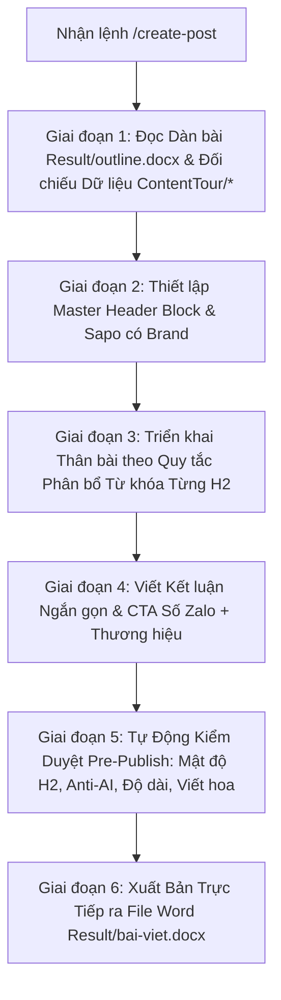

# WORKFLOW: QUY TRÌNH VIẾT BÀI BÁO / BÀI TOUR CHUẨN SEO HOÀN CHỈNH (/create-post)

Quy trình này hướng dẫn chi tiết từng bước mà Agent thực hiện ngay khi nhận được lệnh `/create-post`, đảm bảo chuyển hóa dàn bài đã duyệt từ `Result/outline.docx` thành một bài viết hoàn chỉnh chuẩn SEO 100%, tự nhiên như người thật viết và xuất trực tiếp ra file Word `Result/bai-viet.docx`.

---

## TỔNG QUAN LUỒNG THỰC THI (6 GIAI ĐOẠN)



---

## CHI TIẾT CÁC BƯỚC TRIỂN KHAI

### BƯỚC 1: TIẾP NHẬN DÀN BÀI & ĐỐI CHIẾU NGUỒN DỮ LIỆU
1. **Đọc Dàn ý Đã Duyệt**:
   - Sử dụng script đọc file Word:
     ```powershell
     python .agents/scripts/read_docx.py Result/outline.docx
     ```
   - Trích xuất: Danh sách từ khóa (Bảng KEY & VOLUME), SEO Title, Meta Description, Thẻ H1, Đoạn mở bài (Sapo), hệ thống Headings (H2, H3, H4) và Ma trận phân bổ nội dung.
2. **Đối chiếu Dữ liệu Nguồn Thực tế**:
   - **Bài viết Tour (`[tour]`)**: Đọc tài liệu tour thực tế trong thư mục `ContentTour/*`. Khớp nối chính xác 100% số liệu: mã chuyến bay, giờ bay, giá tour, khách sạn, điểm tham quan, quà tặng (cáp treo, xe điện, bữa ăn đặc sản), điều khoản bao gồm / không bao gồm và chính sách trẻ em. Tuyệt đối không chỉnh sửa hay ghi đè thư mục `ContentTour/*`.
   - **Bài viết Blog (`[blog]`)**: Triển khai sâu theo các đề mục đã duyệt, đưa thông tin thực tế, mẹo sinh hoạt, góc ảnh đẹp, kinh nghiệm thực chiến độc lạ.

---

### BƯỚC 2: KHỞI TẠO MASTER HEADER BLOCK & SAPO
Mọi bài viết xuất ra file Word bắt buộc bắt đầu bằng khối thông tin chuẩn:
1. **Bảng KEY & VOLUME**: Hàng tiêu đề nền vàng tươi (`#FFFF00`), chữ in hoa đậm căn giữa. Cột 1 là danh sách cụm từ khóa (chính và phụ của người dùng), Cột 2 là Volume.
2. **Dòng Check spin**: `Check spin: 0% (100% Unique)`
3. **Dòng Check AI**: `Check AI: 0%`
4. **Dòng Key chính**: `Key chính: [Từ khóa chính]`
5. **Dòng Meta**: `Meta: [Nội dung Meta 140 - 155 ký tự có CTA]`
6. **Dòng Title**: `Title: [Nội dung SEO Title 55 - 60 ký tự, Key 1 ở đầu, có số, từ bổ trợ]`
7. **Dòng H1**: `H1: [Nội dung Thẻ H1 55 - 60 ký tự - BẮT BUỘC KHÁC TITLE 100% (tối ưu Key 2 nếu có nhiều key, hoặc khác biệt hoàn toàn cấu trúc & góc giật tít nếu chỉ có 1 key)]`
8. **Đoạn Sapo**: Bắt đầu ngay dưới dòng `H1:`.
   - Độ dài: **2 - 3 câu ngắn (<155 từ)**.
   - **Bắt buộc chứa Key chính ngay trong 100 từ đầu tiên**.
   - **Bắt buộc nhắc tên thương hiệu công ty và gắn link website**: Bắt buộc gắn link website chính thức trực tiếp vào tên công ty theo dạng anchor text `[Tên công ty](URL website)`.

---

### BƯỚC 3: QUY TẮC BẮT BUỘC VỀ SỰ HIỆN DIỆN CỦA TỪ KHÓA TRONG MỌI MỤC H2

Đây là tiêu chuẩn cốt lõi nhằm đảm bảo tín hiệu SEO luôn liên tục, dày dặn vừa phải và loại bỏ triệt để các khoảng "trống key":

1. **MỤC H2 NÀO CŨNG BẮT BUỘC CÓ TỐI THIỂU 2 - 3 KEY CHÍNH TRONG THÂN BÀI**:
   - Trong **mọi mục H2** (tính toàn bộ nội dung thân bài và các H3/H4 trực thuộc mục H2 đó), từ khóa chính **BẮT BUỘC PHẢI XUẤT HIỆN TỐI THIỂU TỪ 2 ĐẾN 3 LẦN**.
   - **TIÊU ĐỀ H2 KHÔNG ĐƯỢC TÍNH**: Nếu từ khóa chính có mặt trong chính tiêu đề thẻ H2 thì **TUYỆT ĐỐI KHÔNG ĐƯỢC TÍNH** là 1 lần xuất hiện. Toàn bộ định mức tối thiểu 2 - 3 lần bắt buộc phải nằm trọn vẹn trong các câu văn nội dung thân bài của mục H2 đó.
2. **BẮT BUỘC CÓ KEY PHỤ HIỂN THỊ CÙNG TRONG TỪNG MỤC H2**:
   - Ở mỗi mục H2, bên cạnh 2 - 3 lần xuất hiện của key chính, Agent **bắt buộc phải rải thêm các từ khóa phụ (Key phụ 1, Key phụ 2...) hiển thị cùng** một cách nhịp nhàng.
   - Đan xen key chính và key phụ giữa các đoạn hoặc các mục H3 con, tạo nên một mạng lưới từ khóa bao phủ tự nhiên.
3. **TRIỆT TIÊU HOÀN TOÀN VÙNG "TRỐNG KEY" & KHOẢNG CÁCH QUÁ XA**:
   - Tuyệt đối không để xảy ra tình trạng viết liên tục 150 - 250 từ hoặc nguyên một mục H2 mà chỉ có tiêu đề có key, còn phần nội dung thân bài bên dưới hoàn toàn vắng bóng từ khóa.
   - Khoảng cách giữa các lần xuất hiện key phải vừa phải (trung bình 60 - 100 từ có 1 tín hiệu key chính hoặc key phụ).
4. **QUY TẮC TRÁNH ĐẶT KEY NGAY CẠNH TIÊU ĐỀ H2, H3 (ƯU TIÊN HIỂN THỊ Ở KHOẢNG GIỮA ĐOẠN/MỤC)**:
   - **Hạn chế tối đa việc hiển thị key ngay sát cạnh tiêu đề H2, H3**: Tuyệt đối không vừa dứt dòng tiêu đề H2/H3 xuống dòng là câu văn đầu tiên đã lập tức nhồi ngay từ khóa chính hoặc key phụ (như lỗi: `1.1. Khách sạn...` -> `Tham gia tour Trùng Khánh...`, hay `2. Lịch trình...` -> `Lịch trình tour Trùng Khánh...`). Cách chèn này tạo cảm giác máy móc, lặp từ thô cứng và rất gượng gạo.
   - **Nên hiển thị key ở vị trí khoảng giữa**: Câu mở đầu dưới heading nên dùng để dẫn dắt bối cảnh hoặc nêu thông tin thực tế tự nhiên. Sau đó mới đưa từ khóa xuất hiện ở **vị trí khoảng giữa đoạn văn** (sau khi đã đi qua 1 - 2 câu dẫn dắt) hoặc ở **đoạn văn thứ 2, thứ 3** trong nhánh nội dung đó, giúp mạch đọc mượt mà và tự nhiên nhất.
4. **VĂN PHONG TỰ NHIÊN, KHÔNG GƯỢNG ÉP**:
   - Tuyệt đối không nhồi nhét từ khóa thô cứng.
   - Hòa tan từ khóa mượt mà vào lời chia sẻ thực tế, đúng ngữ pháp tiếng Việt.

---

5. **Quy chuẩn Gắn Link Website vào Tên Công Ty (Brand Anchor Text Link)**:
   - Toàn bộ các vị trí nhắc đến tên công ty / thương hiệu (đoạn Sapo, thân bài, Kết luận CTA...) **bắt buộc phải gắn link website chính thức trực tiếp vào tên công ty** (Anchor text là tên công ty, ví dụ: `[LE Travel](http://Letravel.vn)`).
   - Tuyệt đối không để tên công ty ở dạng text trơn không gắn link.

---

### BƯỚC 4: TIÊU CHUẨN THÂN BÀI, UX WRITING & ANTI-AI 0%
1. **Câu văn ngắn gọn & Đoạn văn thông thoáng**:
   - Mỗi câu chỉ tải đúng 1 ý, độ dài **10 - 15 từ/câu** (tối đa ≤ 18 từ).
   - Đoạn văn chỉ từ **1 - 3 câu/đoạn**.
2. **Cắt bỏ hoàn toàn hoa mỹ & sáo rỗng (Zero Fluff)**:
   - Nghiêm cấm các từ ngữ sến súa: *"điểm hẹn trong mơ", "tâm hồn mê xê dịch", "hít căng lồng ngực", "bức tranh tuyệt mỹ", "thiên đường nơi hạ giới"...*
   - Cung cấp thông tin thực tế, con số cụ thể, mốc thời gian rõ ràng.
3. **Tuân thủ Tuyệt đối Danh sách đen Cú pháp AI (Anti-AI Blacklist)**:
   - **CẤM TUYỆT ĐỐI**: *"bạn nên...", "bạn cần...", "bạn phải...", "bạn hãy...", "du khách nên/cần/phải..."*. (Thay bằng câu trần thuật khách quan hoặc chỉ dẫn hành động trực diện).
   - **CẤM**: *"Bạn có thể tự do [động từ]..."* (Thay bằng câu miêu tả thực tế dịch vụ).
   - **CẤM**: *"Đây là dịp / cơ hội tuyệt vời để..."*.
   - **CẤM** liên từ chuyển tiếp máy móc ở đầu câu (*"Tiếp đó...", "Sau đó xe đưa...", "Kế tiếp...", "Đồng thời..."*).
4. **Kỹ thuật Burstiness (Tạo độ gãy nhịp tự nhiên của con người)**:
   - Sau 1 - 2 câu trần thuật 10 - 14 từ, đan xen 1 câu siêu ngắn 3 - 6 từ (*"Đường khá dốc."*, *"Trời rét nhanh."*, *"Xe chạy rất êm."*, *"Chuẩn bị từ sớm."*).
5. **Quy chuẩn Bắt buộc Viết Hoa Toàn bộ Địa danh & Tên Người**:
   - Viết hoa đúng chính tả 100% các danh từ riêng: *Hà Nội, Trùng Khánh, Lệ Giang, Shangrila, Núi Tuyết Ngọc Long, Vân Tam Bình, Bạch Thủy Hà, Cam Hải Tử, Ngọc Thủy Trại, Mộc Phủ, Hắc Long Đàm, Tùng Tán Lâm Tự, Pudacuo, Hổ Khiêu Hiệp, Trương Nghệ Mưu, Naxi, Đông Ba...*
   - Kể cả khi từ khóa người dùng cung cấp viết chữ thường, khi đưa vào câu văn bài viết bắt buộc phải viết hoa đúng địa danh.
6. **Quy chuẩn Ghi Chú Ảnh Ngắn Gọn (Simple Red Notes)**:
   - Cứ mỗi 250 - 350 từ hoặc mỗi H2/H3 chèn một dòng ghi chú mô tả ảnh **ngắn gọn, đơn giản, dễ hiểu**, đặt trong ngoặc đơn `(...)` với màu đỏ `#C00000`.
   - Không ghi thông số kỹ thuật rườm rà (bỏ pixel, dung lượng, alt, file name...).

---

### BƯỚC 5: XÂY DỰNG KẾT LUẬN & CTA CHUẨN MỰC
1. **Độ dài**: Viết **thật ngắn gọn, súc tích (chỉ từ 2 - 3 câu ngắn hoặc dưới 50 - 80 từ)**. Tuyệt đối không kéo dài lê thê, không triết lý sáo rỗng.
2. **Nội dung bắt buộc**:
   - Chứa **1 lần từ khóa chính**.
   - **Lời kêu gọi hành động (CTA) dứt khoát gắn liền với số Zalo tư vấn và tên thương hiệu công ty** (trong đó tên công ty bắt buộc được gắn link website chính thức theo dạng anchor text `[Tên công ty](URL website)`).
3. **Ngoại lệ bắt buộc**: **Tuyệt đối không chèn ảnh hay ghi chú note ảnh trong phần Kết luận**.

---

### BƯỚC 6: TỰ ĐỘNG KIỂM DUYỆT TRƯỚC KHI XUẤT BẢN (AUDIT & EXPORT)
Trước khi xuất file `.docx`, Agent bắt buộc tự động kiểm tra đối soát:
- [ ] **Mật độ H2**: Mọi mục H2 đều có ≥ 2 - 3 lần key chính trong thân bài (loại trừ tiêu đề H2) + key phụ hiển thị cùng.
- [ ] **Khoảng cách key**: Không có đoạn văn nào bị trống key > 150 từ.
- [ ] **Độ dài bài viết**: Tính từ dòng `H1:` đến hết bài nằm trong khoảng **1.800 – 2.500 từ**.
- [ ] **Title & H1**: Khác nhau 100% (Title tối ưu Key 1, H1 tối ưu Key 2 hoặc khác biệt hoàn toàn cấu trúc).
- [ ] **AI Blacklist**: 0% từ cấm ("bạn nên", "bạn cần", "bạn phải", "tự do thưởng thức"...).
- [ ] **Check spin**: Đạt 0% trùng lặp (100% Unique).
- [ ] **Viết hoa địa danh**: 100% danh từ riêng viết hoa chuẩn chính tả.
- [ ] **Định dạng Word**: Font Google Sans Flex 13pt (H1: 16pt bold căn giữa), bảng có viền đen nền trắng tiêu đề cột in đậm căn giữa, ghi chú ảnh chữ đỏ `#C00000` trong ngoặc đơn, chữ đen mặc định toàn bài.
- [ ] **Đường dẫn lưu file**: Xuất trực tiếp và duy nhất vào **`Result/bai-viet.docx`**. Không lưu file `.md` hay file nháp ở thư mục gốc.

